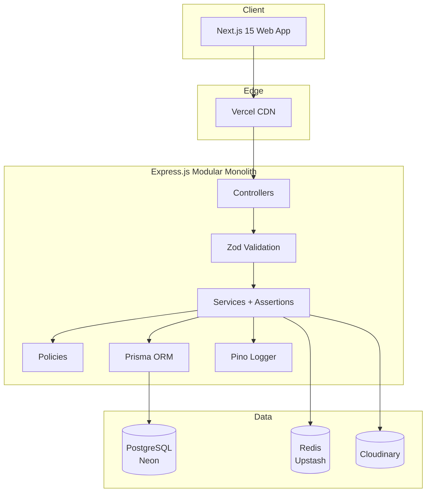
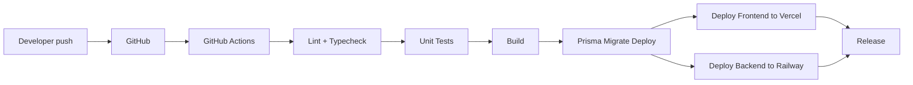
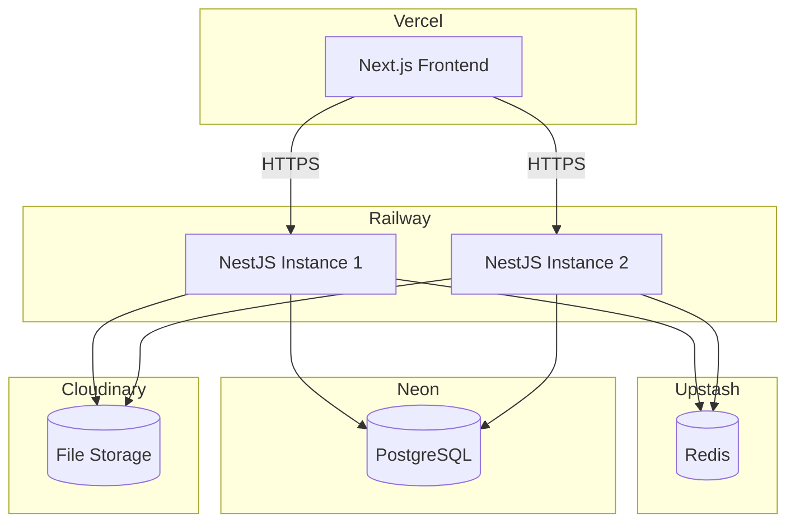

# System Architecture Specification (Hackathon-Optimized)

## Gaza Aid Distribution & NGO Management System

**Version:** 2.0  
**Document Type:** Architecture Specification  
**Architecture Style:** Modular Monolith  
**Prepared for:** Gaza-based Humanitarian NGO  
**Status:** Approved for Implementation  

---

## Table of Contents

1. [Architecture Overview](#1-architecture-overview)
2. [Design Principles](#2-design-principles)
3. [Technology Stack](#3-technology-stack)
4. [Backend Structure](#4-backend-structure)
5. [Module Internal Structure](#5-module-internal-structure)
6. [Frontend Structure](#6-frontend-structure)
7. [Validation Strategy](#7-validation-strategy)
8. [Authorization Strategy](#8-authorization-strategy)
9. [Authentication](#9-authentication)
10. [Data Layer](#10-data-layer)
11. [Caching Strategy](#11-caching-strategy)
12. [Logging](#12-logging)
13. [File Storage](#13-file-storage)
14. [File Generation](#14-file-generation)
15. [Deployment](#15-deployment)
16. [What Was Removed & Why](#16-what-was-removed--why)
17. [What Was Kept & Why](#17-what-was-kept--why)
18. [Roadmap: Post-Hackathon Evolution](#18-roadmap-post-hackathon-evolution)
19. [Summary](#19-summary)

---

## 1. Architecture Overview

### 1.1 Architecture Style

**Modular Monolith** a single Express.js application organized into clear feature-based modules. Each module owns its controllers, services, schemas, policies, and types. Modules communicate through service interfaces, never by directly accessing another module's database tables.

### 1.2 Why Modular Monolith

| Consideration | Rationale |
|---|---|
| Team size | Small team (2–5 developers) delivering in days/weeks |
| Operational simplicity | Single deployment, single database, single log stream |
| Development speed | No cross-service networking, no distributed transactions |
| Future growth | Strong internal boundaries allow extracting services later without rewriting |
| Transactional integrity | Donations → inventory → finance settlements stay in one ACID transaction |

### 1.3 High-Level Diagram



---

## 2. Design Principles

| # | Principle | Application |
|---|---|---|
| 1 | **REST API** | Resource-oriented endpoints, standard HTTP verbs, proper status codes |
| 2 | **Feature-Based Modules** | Each business capability lives in `src/modules/<feature>/` |
| 3 | **Multiple Controllers & Services per Module** | Split by sub-resource (families, members, assessments, requests) |
| 4 | **Zod for Validation** | Single schema source shared between frontend and backend |
| 5 | **Service Assertions** | Business rules enforced inside services via `assert*()` methods |
| 6 | **Policies for Authorization** | `canX()` functions keep permission logic out of services |
| 7 | **RBAC** | Route-level `@Roles()` decorator + policy enforcement |
| 8 | **JWT Authentication** | Access token (15 min) + refresh token (simple rotation) |
| 9 | **Argon2id** | Modern password hashing |
| 10 | **Audit Logging** | Every sensitive mutation writes to `audit_logs` with before/after JSONB |
| 11 | **Soft Delete** | Users, families, donors, projects deactivated, never physically deleted |
| 12 | **PostgreSQL as Source of Truth** | Money, inventory, families all live in PostgreSQL |
| 13 | **Transactions for Cross-Domain Writes** | Donation settlement, distribution, and inventory movements use Prisma `$transaction` |
| 14 | **Bilingual UI** | Arabic primary, English secondary |
| 15 | **Pragmatic Simplicity** | No abstractions that add files without immediate value |

---

## 3. Technology Stack

### 3.1 Frontend

| Layer | Technology | Purpose |
|---|---|---|
| Framework | Next.js 15 | App Router, SSR, routing |
| Language | TypeScript | Type safety |
| Styling | Tailwind CSS | Utility-first styling |
| UI Components | Shadcn/UI | Accessible primitives |
| Forms | React Hook Form | Controlled forms |
| Validation | Zod | Shared schemas with backend |
| Server State | TanStack Query | Caching, mutations, invalidation |
| Tables | TanStack Table | Sortable, filterable tables |
| Charts | Recharts | Dashboard charts |
| i18n | next-intl | Arabic/English support |

### 3.2 Backend

| Layer | Technology | Purpose |
|---|---|---|
| Framework | Express.js | Modular HTTP framework |
| Language | TypeScript | Type safety |
| ORM | Prisma | Type-safe database access |
| Database | PostgreSQL | Source of truth |
| Cache | Redis | Dashboard/report caching, rate limiting |
| Validation | Zod | Request schema validation |
| Auth | JWT + Argon2id | Token authentication + password hashing |
| Logging | Pino | Structured JSON logging |
| API Docs | Swagger | OpenAPI generation |
| Excel | ExcelJS | Excel report generation |
| PDF | pdf-lib | PDF receipts and reports |

### 3.3 Infrastructure

| Layer | Technology | Purpose |
|---|---|---|
| Frontend Hosting | Vercel | Edge CDN, preview deployments |
| Backend Hosting | Railway | Container hosting |
| Database | Neon PostgreSQL | Serverless Postgres |
| Cache | Upstash Redis | Managed Redis |
| File Storage | Cloudinary | Uploads, CDN, signed URLs |
| CI/CD | GitHub Actions | Lint, test, build, deploy |

---

## 4. Backend Structure

### 4.1 Directory Layout

```
src/
├── modules/
│   ├── auth/
│   ├── users/
│   ├── branches/
│   ├── families/
│   ├── projects/
│   ├── inventory/
│   ├── distributions/
│   ├── donors/
│   ├── financial-accounts/
│   ├── financial-transactions/
│   ├── reporting
│   └── audit/
│
├── common/
│   ├── guards/
│   ├── decorators/
│   ├── interceptors/
│   ├── filters/
│   ├── pipes/
│   └── utils/
│
├── database/
│   ├── prisma/
│   ├── migrations/
│   └── seed/
│
├── config/
│
└── main.ts

<module-name>/
│
├── controllers/
│   └── <resource>.controller.ts        ← One controller per sub-resource
│
├── services/
│   └── <resource>.service.ts           ← One service per sub-resource
│
├── schemas/
│   ├── create-<resource>.schema.ts     ← Zod input schemas
│   ├── update-<resource>.schema.ts
│   └── query-<resource>.schema.ts
│
├── policies/
│   └── <resource>.policy.ts            ← Permission and scope rules
│
├── types/
│   ├── enums/
│   │   └── <resource>.enum.ts          ← Module-specific enums
│   ├── interfaces/
│   │   └── <resource>.interface.ts     ← Internal interfaces
│   └── types.ts                        ← Types inferred from Zod schemas
│
├── utils/
│   └── <resource>.util.ts              ← Pure helpers (formatting, computation)
│
├── tests/
│   ├── <resource>.service.spec.ts      ← Unit tests
│   └── <resource>.controller.spec.ts   ← Controller tests
├── repositories/
├── <resource>.service.spec.ts      ← Unit tests
│   └── <resource>.controller.spec.ts  
│
└── <module-name>.module.ts             ← NestJS module wiring
```

### 4.2 Module Responsibility Map

| Module | Responsibility | Core Tables |
|---|---|---|
| `auth` | Register, login, logout, refresh, password reset | `users` |
| `users` | Employee CRUD, activation, role change | `users` |
| `branches` | Branch CRUD, activation, statistics | `branches` |
| `families` | Families, members, assessments, family requests | `families`, `family_members`, `family_assessments`, `family_requests`, `addresses` |
| `projects` | Project CRUD, lifecycle, beneficiaries generation | `projects`, `project_parcels` |
| `project-beneficiaries` | Beneficiary selection, eligibility filtering | (project-scoped) |
| `inventory` | Categories, items, inventories, stock, inventory transactions | `categories`, `items`, `inventories`, `inventory_items`, `inventory_transactions`, `inventory_transaction_items`, `inventory_transaction_parcels` |
| `parcels` | Parcel templates, items, usage | `parcel_templates`, `parcel_items` |
| `distributions` | Distribution CRUD, receipts | `distributions` |
| `donors` | Donor CRUD, statistics, top donors | `donors` |
| `donation-requests` | Donor pledges with review workflow | `donation_requests` |
| `donations` | Donation CRUD, settlement, traceability | `donations` |
| `financial-accounts` | Account CRUD, balance, transactions | `financial_accounts` |
| `financial-transactions` | Money movements (donation, transfer, allocation, expense) | `financial_transactions` |
| `expense-categories` | Expense category CRUD, summary | `expense_categories` |
| `reports` | Cross-module report aggregation | (read-only) |
| `analytics` | Dashboard KPIs and charts | (read-only) |
| `audit` | Audit log query, entity history | `audit_logs` |

**Total: 18 modules**

### 4.3 Module Dependency Rules

```
auth              → users
users             → branches, audit
branches          → audit
families          → users, branches, audit
projects          → users, audit
project-beneficiaries → projects, families
inventory         → branches, items, categories, donations, projects, audit
parcels           → items, audit
distributions     → families, branches, projects, parcels, users, inventory, audit
donors            → audit
donation-requests → donors, projects, users, audit
donations         → donors, projects, donation-requests, inventory, financial-transactions, users, audit
financial-accounts → audit
financial-transactions → financial-accounts, expense-categories, donations, projects, users, audit
expense-categories → audit
reports           → (read-only) all modules
analytics         → (read-only) all modules
audit             → (read-only) audit_logs
```

**Rules:**
- No cyclic dependencies.
- Cross-module reads call the owning module's **exported service**.
- Cross-module writes call the owning module's **service method** (e.g., `DonationsService` calls `InventoryService.createDonationTransaction()`).
- `reports` and `analytics` are read-only and compose data via public service methods.

---

## 5. Module Internal Structure

Every feature module follows this pattern:

```
families/
├── controllers/
│   ├── families.controller.ts
│   ├── family-members.controller.ts
│   ├── family-assessments.controller.ts
│   └── family-requests.controller.ts
│
├── services/
│   ├── families.service.ts
│   ├── family-members.service.ts
│   ├── family-assessments.service.ts
│   └── family-requests.service.ts
│
├── schemas/
│   ├── create-family.schema.ts
│   ├── update-family.schema.ts
│   ├── create-member.schema.ts
│   ├── create-assessment.schema.ts
│   └── create-family-request.schema.ts
│
├── policies/
│   └── family.policy.ts
│
├── types/
│   ├── enums/
│   ├── interfaces/
│   └── types.ts
│
├── utils/
│
├── tests/
│   ├── families.service.spec.ts
│   └── families.controller.spec.ts
│
└── families.module.ts
```

### 5.1 File Responsibilities

| File | Responsibility | Allowed Dependencies |
|---|---|---|
| `controllers/*.controller.ts` | Parse request, validate Zod schema, call service | Schemas, services, guards, decorators |
| `services/*.service.ts` | Business logic, assertions, transactions, audit | Prisma, policies, schemas, other services |
| `schemas/*.schema.ts` | Zod request/response schemas and inferred types | `zod` |
| `policies/*.policy.ts` | Permission and scope rules (`canX()`) | Types |
| `types/*` | Enums, interfaces, DTOs inferred from Zod | Nothing |
| `*.module.ts` | NestJS module wiring | Controllers, services |

### 5.2 Standard Controller Pattern

```ts
@Controller('families')
@UseGuards(JwtAuthGuard, RolesGuard)
export class FamiliesController {
  constructor(private readonly families: FamiliesService) {}

  @Post()
  @Roles(UserRole.ADMIN, UserRole.BRANCH_MANAGER, UserRole.FIELD_RESEARCHER)
  create(
    @Body(new ZodPipe(CreateFamilySchema)) dto: CreateFamilyDto,
    @CurrentUser() actor: AuthUser,
  ) {
    return this.families.create(dto, actor);
  }

  @Patch(':id/verify')
  @Roles(UserRole.ADMIN, UserRole.BRANCH_MANAGER)
  verify(@Param('id') id: string, @CurrentUser() actor: AuthUser) {
    return this.families.verify(id, actor);
  }
}
```

### 5.3 Standard Service Pattern

```ts
@Injectable()
export class FamiliesService {
  constructor(
    private readonly prisma: PrismaService,
    private readonly policy: FamilyPolicy,
    private readonly audit: AuditService,
  ) {}

  async verify(id: string, actor: AuthUser) {
    const family = await this.prisma.family.findUniqueOrThrow({ where: { id } });

    this.policy.assertCanVerify(actor, family);
    this.assertStatusTransition(family.status, FamilyStatus.VERIFIED);

    const updated = await this.prisma.family.update({
      where: { id },
      data: {
        status: FamilyStatus.VERIFIED,
        verifiedBy: actor.id,
        verifiedAt: new Date(),
      },
    });

    await this.audit.log({
      userId: actor.id,
      entityName: 'families',
      entityId: family.id,
      action: AuditAction.VERIFY,
      oldValues: { status: family.status },
      newValues: { status: updated.status },
    });

    return updated;
  }

  private assertStatusTransition(from: FamilyStatus, to: FamilyStatus) {
    if (from !== FamilyStatus.PENDING) {
      throw new BadRequestException('Only pending families can be verified');
    }
  }
}
```

### 5.4 Standard Policy Pattern

```ts
@Injectable()
export class FamilyPolicy {
  assertCanVerify(actor: AuthUser, family: Family) {
    if (actor.role === UserRole.ADMIN) return;
    if (actor.role === UserRole.BRANCH_MANAGER && family.branchId === actor.branchId) return;
    throw new ForbiddenException('Not allowed to verify this family');
  }

  assertCanEdit(actor: AuthUser, family: Family) { ... }
  assertCanReject(actor: AuthUser, family: Family) { ... }
}
```

### 5.5 Request Flow

```
Request
  ↓
Controller (RBAC route guard)
  ↓
Zod schema validation (ZodPipe)
  ↓
Service (business logic + assertions)
  ↓
Policy (permission + scope checks)
  ↓
Prisma (transactional write/read)
  ↓
PostgreSQL
  ↓
Audit log (for mutations)
  ↓
Response
```

---

## 6. Frontend Structure

### 6.1 Directory Layout

```
app/
├── (auth)/
│   ├── login/
│   ├── register/
│   └── reset-password/
│
├── (dashboard)/
│   ├── dashboard/
│   ├── families/
│   ├── projects/
│   ├── beneficiaries/
│   ├── distributions/
│   ├── inventory/
│   ├── parcels/
│   ├── donors/
│   ├── donation-requests/
│   ├── donations/
│   ├── accounts/
│   ├── financial-transactions/
│   ├── expense-categories/
│   ├── reports/
│   ├── analytics/
│   ├── audit-logs/
│   ├── users/
│   └── branches/
│
├── (portal)/
│   ├── donor/
│   └── beneficiary/
│
├── layout.tsx
└── page.tsx

components/
├── ui/                    ← Shadcn primitives
├── layout/
├── data-table/
├── forms/
├── charts/
└── shared/

lib/
├── api/                   ← Typed API client + TanStack hooks
├── auth/                  ← Session, token refresh
├── schemas/               ← Shared Zod schemas
└── utils/

hooks/
├── queries/
└── mutations/
```

### 6.2 Frontend Principles

| Principle | Application |
|---|---|
| **Server Components by default** | Data fetching on server where possible |
| **TanStack Query for interactivity** | Caching, optimistic updates, invalidation |
| **React Hook Form + Zod** | Schemas shared with backend contracts |
| **RTL-first UI** | Arabic default, English secondary |
| **Role-aware navigation** | Sidebar filtered from session role |
| **Optimistic UI** | Approvals, cancellations update instantly, roll back on error |

---

## 7. Validation Strategy

### 7.1 Single Zod Schema per Operation

Schemas live in the module's `schemas/` folder and are imported by **both** frontend and backend.

```ts
// modules/families/schemas/create-family.schema.ts
import { z } from 'zod';

export const CreateFamilySchema = z.object({
  primaryPhone: z.string().min(6).max(30),
  emergencyPhone: z.string().min(6).max(30).optional(),
  originalAddressId: z.string().uuid(),
  currentAddressId: z.string().uuid(),
  members: z.array(CreateFamilyMemberSchema).min(1),
});

export type CreateFamilyDto = z.infer<typeof CreateFamilySchema>;
```

### 7.2 Backend Enforcement

```ts
@Post()
create(@Body(new ZodPipe(CreateFamilySchema)) dto: CreateFamilyDto) { ... }
```

### 7.3 Frontend Enforcement

```ts
const form = useForm<CreateFamilyDto>({
  resolver: zodResolver(CreateFamilySchema),
});
```

### 7.4 Validation Layers

| Layer | Tool | Handles |
|---|---|---|
| **Transport** | Zod schemas | Types, formats, required fields, enums |
| **Business** | Service assertions | Cross-field rules, state transitions, ownership |
| **Database** | PostgreSQL constraints | Enums, foreign keys, CHECK constraints, unique indexes |

### 7.5 Business Rules via Assertions

Business rules that Zod cannot express stay in services:

```ts
private assertDonationSettlementType(donation: Donation) {
  if (donation.donationType === DonationType.MONETARY && donation.inventoryTransactions.length > 0) {
    throw new BadRequestException('Monetary donations cannot have inventory transactions');
  }
}

private assertRejectRequiresReason(reason?: string) {
  if (!reason) throw new BadRequestException('Rejection reason is required');
}
```

---

## 8. Authorization Strategy

### 8.1 RBAC at Three Layers

| Layer | Mechanism | Purpose |
|---|---|---|
| **Route** | `@Roles(UserRole.ADMIN, ...)` + `RolesGuard` | Reject unauthorized roles before service execution |
| **Service** | `assertX()` methods | Enforce workflow and state rules |
| **Policy** | `canX()` / `assertCanX()` | Ownership, branch scope, entity-specific rules |

### 8.2 Policy Files

Each module owns a `policies/` folder:

```
families/policies/family.policy.ts
projects/policies/project.policy.ts
donations/policies/donation.policy.ts
inventory/policies/inventory.policy.ts
financial-transactions/policies/financial-transaction.policy.ts
```

Example:

```ts
@Injectable()
export class DonationPolicy {
  assertCanEdit(actor: AuthUser, donation: Donation) {
    if (donation.status === DonationStatus.RECEIVED) {
      throw new BadRequestException('Received donations cannot be edited');
    }
    if (actor.role === UserRole.FINANCE_MANAGER && donation.donationType === DonationType.MONETARY) return;
    if (actor.role === UserRole.INVENTORY_MANAGER && donation.donationType !== DonationType.MONETARY) return;
    if (actor.role === UserRole.ADMIN) return;
    throw new ForbiddenException();
  }

  assertCanApproveRequest(actor: AuthUser, request: DonationRequest) { ... }
}
```

### 8.3 Role → Scope Map

| Role | Scope | Enforced By |
|---|---|---|
| ADM | Global | No filter |
| MGR | Own branch | Policy checks `branchId` |
| RES | Own branch + own created families | Policy checks `branchId` + `createdBy` |
| INV | Global inventory | No filter |
| FIN | Global finance | No filter |
| DNR | Own donations only | Service filters by `donorId` |
| MBR | Own family only | Service filters by `familyId` |

---

## 9. Authentication

### 9.1 Token Strategy

| Token | Lifetime | Storage | Purpose |
|---|---|---|---|
| Access Token | 15 minutes | httpOnly cookie | Authorize API requests |
| Refresh Token | 7 days | httpOnly cookie | Obtain new access token |

**Algorithm:** HS256 (symmetric) — appropriate for the current scale. Upgrade to RS256 if external services need to verify tokens.

### 9.2 JWT Claims

```json
{
  "sub": "user-uuid",
  "role": "BRANCH_MANAGER",
  "branchId": "branch-uuid",
  "publicId": "MGR-0005",
  "iat": 1735689600,
  "exp": 1735690500
}
```

### 9.3 Refresh Token (Simple Rotation)

- Refresh endpoint issues a new access token and a new refresh token.
- Old refresh token is invalidated in Redis with a short TTL.
- Advanced reuse detection and token-family revocation are **deferred to post-hackathon**.

### 9.4 Password Hashing

- **Algorithm:** Argon2id
- **Parameters:** `memoryCost: 19456 KiB`, `timeCost: 2`, `parallelism: 1` (OWASP baseline)
- **Storage:** `users.password_hash` TEXT

### 9.5 Auth Flows

| Flow | Endpoint | Notes |
|---|---|---|
| Beneficiary registration | `POST /auth/register/beneficiary` | Public |
| Donor registration | `POST /auth/register/donor` | Public |
| Login | `POST /auth/login` | Public |
| Logout | `POST /auth/logout` | Authenticated |
| Refresh | `POST /auth/refresh` | Authenticated |
| Forgot / Reset password | `POST /auth/forgot-password`, `POST /auth/reset-password` | Public |
| Change password | `PUT /auth/change-password` | Authenticated |
| My profile | `GET /auth/me`, `PUT /auth/me` | Authenticated |

---

## 10. Data Layer

### 10.1 Prisma Setup

- **Schema:** `src/database/prisma/schema.prisma`
- **Migrations:** `src/database/migrations/` (committed to git)
- **Seed:** `src/database/seed/` (default admin, sample branches, categories, expense categories)
- **Client:** Singleton `PrismaService` extending `PrismaClient`, initialized `onModuleInit`

### 10.2 Transaction Strategy

Cross-domain writes must use Prisma `$transaction`:

| Operation | Tables Touched |
|---|---|
| Settle monetary donation | `donations`, `financial_transactions` |
| Settle physical donation | `donations`, `inventory_transactions`, `inventory_transaction_items`/`_parcels`, `inventory_items` |
| Record distribution | `distributions`, `project_parcels`, `inventory_items` |
| Transfer inventory | `inventory_transactions`, `inventory_transaction_items`, `inventory_items` (×2) |
| Approve family request | `family_requests`, `families`/`family_members`, `audit_logs` |

Example:

```ts
await this.prisma.$transaction(async (tx) => {
  const donation = await tx.donation.create({ data: { ... } });
  await tx.financialTransaction.create({ data: { donationId: donation.id, ... } });
  return donation;
});
```

### 10.3 ID Strategy

| Entity Type | ID | Rationale |
|---|---|---|
| Internal PK | `BIGSERIAL` | Fast joins, compact indexes |
| Public readable ID | `PREFIX-NNNNNN` | Safe to expose (e.g., `FAM-000123`) |
| Public opaque ID | UUID v4 | Used for `donation_requests`, `family_requests` |

**Rule:** API responses and request lookups use `public_id`, never internal `id`.

### 10.4 Soft Delete

| Entity | Mechanism |
|---|---|
| `users` | `is_active = false` |
| `branches` | `is_active = false` |
| `families` | `status = REJECTED` (never deleted) |
| `donors` | No delete (historical donations preserved) |
| `projects` | Only `DRAFT` can be hard-deleted; otherwise `status = CANCELLED` |

Physical deletes are reserved for:
- `family_members` (ADM/MGR only, no distribution references)
- Draft projects
- Unused categories, items, parcels, expense categories

---

## 11. Caching Strategy

### 11.1 Redis Usage

| Cache Key | TTL | Invalidated By |
|---|---|---|
| `dashboard:{role}:{scope}` | 5 min | Any mutation in scope |
| `analytics:{report}:{params}` | 15 min | Nightly rebuild or manual refresh |
| `report:{type}:{params}` | 15 min | Same as analytics |
| `refresh:{userId}:{jti}` | 7 days | Logout, refresh rotation |
| `rate-limit:{ip}:{route}` | Sliding window | N/A |

### 11.2 What is NOT Cached

- Authentication decisions (always resolve live)
- Permission checks (always from token + policy)
- Financial balances (computed from transactions)
- Audit logs (immutable, never cached)
- Family or beneficiary personal data

### 11.3 Rules

- **PostgreSQL is source of truth.** Redis only caches expensive read aggregates.
- **Write-through invalidation.** Services invalidate affected keys after successful mutations.
- **No stampede.** Use `SETNX` lock for expensive rebuilds.

### 11.4 Scale Expectation for Hackathon

For the hackathon demo, Redis caching may not be exercised heavily. It is included because:
- Cost of adding it early is low (Upstash free tier).
- It provides a foundation for rate limiting and future analytics.
- Removing it later is easy; adding it later is more disruptive.

---

## 12. Logging

### 12.1 Pino Only

| Log Type | Level | Destination |
|---|---|---|
| HTTP request/response | `info` | stdout |
| Business events (create/approve/cancel) | `info` | stdout |
| Warnings | `warn` | stdout |
| Errors | `error` | stdout |
| Debug (dev only) | `debug` | stdout |

**Sentry, Prometheus, Grafana, and ELK stack are intentionally excluded for v1.**

### 12.2 Log Enrichment

Every line includes:

```json
{
  "level": "info",
  "time": 1735689600000,
  "requestId": "uuid",
  "userId": "user-uuid",
  "role": "MGR",
  "method": "POST",
  "path": "/api/v1/families",
  "statusCode": 201,
  "durationMs": 42,
  "msg": "family created"
}
```

### 12.3 Request ID

A `RequestIdInterceptor` generates a UUID per request, attaches it to `req.id` and every log line, and returns it as `X-Request-Id`.

### 12.4 Health Checks

| Endpoint | Purpose |
|---|---|
| `GET /health` | Liveness — returns 200 if process is up |

Readiness, version, and metrics endpoints are deferred to post-hackathon.

---

## 13. File Storage

### 13.1 Cloudinary Usage

| Asset | Path | Visibility |
|---|---|---|
| Beneficiary profile photo | `beneficiaries/{familyId}/{memberId}` | Signed URL |
| Family document scans | `families/{familyId}/documents` | Signed URL |
| NGO logo | `branding/logo` | Public |
| Generated PDFs | `receipts/{distributionId}` | Signed URL, 30-day TTL |

### 13.2 Rules

- All beneficiary assets use signed URLs with short TTL (never public).
- Images are resized on upload (max 1024px width).
- Uploads validated for MIME type and size (≤5 MB).
- Direct browser uploads via signed upload preset — no proxying through backend.

### 13.3 Hackathon Scope

Cloudinary is included from day one because:
- File uploads are otherwise painful to self-host.
- Free tier covers the hackathon demo comfortably.
- Removing it later (if never used) is trivial.

If the team is **not** planning to store any photos or documents in v1, Cloudinary can be omitted entirely and the corresponding endpoints removed.

---

## 14. File Generation

### 14.1 Excel Reports (ExcelJS)

| Report | Endpoint |
|---|---|
| Families export | `GET /families/export` |
| Family members export | `GET /families/{id}/members/export` |
| Project beneficiary list | `GET /projects/{id}/beneficiaries/export` |
| Inventory report | `GET /inventories/{id}/export` |
| Distributions export | `GET /distributions/export` |
| Donations export | `GET /donations/export` |
| Financial ledger export | `GET /financial-transactions/export` |
| Audit log export | `GET /audit-logs/export` |

**Standards:** bilingual headers, auto-fit columns, ISO 8601 dates, metadata sheet with filters applied.

### 14.2 PDF Generation (pdf-lib)

| Document | Endpoint |
|---|---|
| Distribution receipt | `GET /distributions/{id}/receipt` |
| Donor impact report | `GET /reports/donor-impact` |
| Project summary | `GET /projects/{id}/export?format=pdf` |

**Standards:** bilingual, NGO logo, QR code to verification URL, signature line.

### 14.3 Streaming

Files stream to the client via `StreamableFile`. They are not cached on disk.

---

## 15. Deployment

### 15.1 Environments

| Environment | Frontend | Backend | Database | Redis |
|---|---|---|---|---|
| **Local** | `localhost:3000` | `localhost:3001` | Docker Postgres | Docker Redis |
| **Preview** | Vercel Preview | Railway Preview | Neon branch | Upstash ephemeral |
| **Production** | Vercel | Railway | Neon | Upstash |

### 15.2 CI/CD Pipeline



### 15.3 Topology



### 15.4 Environment Variables

| Variable | Scope | Example |
|---|---|---|
| `DATABASE_URL` | Backend | `postgresql://...?sslmode=require` |
| `REDIS_URL` | Backend | `redis://...` |
| `JWT_ACCESS_SECRET` | Backend | 64-byte random string |
| `JWT_REFRESH_SECRET` | Backend | 64-byte random string |
| `JWT_ACCESS_TTL` | Backend | `15m` |
| `JWT_REFRESH_TTL` | Backend | `7d` |
| `CORS_ORIGINS` | Backend | Comma-separated origins |
| `CLOUDINARY_URL` | Backend | `cloudinary://...` |
| `LOG_LEVEL` | Backend | `info` |
| `NEXT_PUBLIC_API_URL` | Frontend | `https://api.example.org/api/v1` |

Configuration is validated by a Zod schema at startup; missing vars cause immediate exit.

### 15.5 Security Hardening

| Area | Measure |
|---|---|
| Transport | HTTPS only, HSTS |
| CORS | Allowlist |
| Rate limiting | `@nestjs/throttler` on auth endpoints |
| Secrets | Railway/Vercel env vars |
| Database | Private network, SSL required |
| Cookies | `httpOnly`, `secure`, `sameSite=strict` |
| Headers | Helmet middleware |
| Input size | 1 MB body limit |
| SQL injection | Prisma parameterized queries only |

---

## 16. What Was Removed & Why

| Removed | Reason | When to Add Back |
|---|---|---|
| **Repository pattern** | Adds a file per module with no benefit at this scale | When write/read models diverge, or module count grows to 40+ |
| **Mapper folders** | Services can return shapes directly | When entity-to-DTO mapping gets complex |
| **Validator folders** | Zod schemas + service assertions cover the same ground | Never — assertions stay in services |
| **Notifications module** | Adds notification table, preferences, and delivery machinery | Post-hackathon, if in-app notifications are needed |
| **Sentry** | Pino logs cover hackathon debugging | When production incidents need error grouping |
| **Prometheus / Grafana / ELK** | Overkill for a demo | When the system has real users and needs SLO monitoring |
| **Readiness/version metrics endpoints** | `/health` is enough for Railway health probes | When multiple instances require traffic gating |
| **Advanced refresh token rotation** (reuse detection, token-family revocation) | Simple rotation is enough for a demo | When handling real user security requirements |
| **Dedicated `family-members`, `family-assessments`, `family-requests` modules** | Members never exist independently; assessments and requests are sub-resources | If a module's controller/service files exceed ~800 lines |
| **`items` and `categories` as separate modules** | Merged into `inventory` | If inventory grows very large |
| **`inventories` and `inventory-transactions` as separate modules** | Merged into `inventory` | Same as above |
| **`financial-accounts` and `financial-transactions`** | Kept separate because they have distinct lifecycles and separate endpoints | N/A — already separate |

### 16.1 Module Count Comparison

| Version | Modules |
|---|---|
| v1.0 (original) | 24 |
| v2.0 (this version) | **18** |

Reduced by merging family sub-resources, inventory sub-resources, and removing notifications.

---

## 17. What Was Kept & Why

| Kept | Why |
|---|---|
| **Modular Monolith** | Correct architecture for team size and timeline |
| **NestJS + Prisma + PostgreSQL** | Best-in-class TypeScript stack |
| **Next.js + TypeScript** | Standard modern frontend |
| **JWT + RBAC** | Simple, stateless, well-understood |
| **Argon2id** | Modern password hashing |
| **Feature-based modules** | Clean boundaries without microservice overhead |
| **Zod everywhere** | One schema, two runtimes |
| **Policies** | Keeps authorization out of services |
| **Assertions in services** | Keeps business rules explicit |
| **Audit logs** | Required for NGO accountability |
| **Financial transactions as source of truth** | Prevents double-counting |
| **Inventory transactions as source of truth** | Single ledger for stock |
| **Donation Request + Family Request workflows** | Core to NGO integrity |
| **Bilingual (Arabic/English)** | Required for Gaza operations |
| **Separate donor and beneficiary portals** | Dignity and privacy |
| **Redis** | Cheap to add now, painful to add later |
| **Cloudinary** | Removes self-hosted file storage pain |
| **Pino** | Lightweight structured logging |
| **ExcelJS + pdf-lib** | Bilingual reports and receipts |
| **Vercel + Railway + Neon + Upstash** | Best free/cheap tier combination |
| **GitHub Actions** | Standard CI/CD |

---

## 18. Roadmap: Post-Hackathon Evolution

The architecture is designed so each of these can be added without rewriting existing code.

### Phase 1 — Hackathon MVP (target: 1–3 weeks)

**Modules:** `auth`, `users`, `families`, `projects`, `inventory`, `donors`, `donations`, `distributions`, `dashboard`

**Core flow:**
1. Family submits request
2. Researcher verifies family
3. Project created
4. Eligible beneficiaries selected
5. Donor creates donation
6. Donation received
7. Inventory updated
8. Distribution recorded
9. Dashboard updated

### Phase 2 — Post-Hackathon (weeks 4–8)

- Add `branches`, `financial-accounts`, `financial-transactions`, `expense-categories`, `audit`, `reports`, `analytics` modules
- Add full audit-log UI
- Add Excel/PDF export endpoints
- Add Sentry

### Phase 3 — Production Hardening (weeks 9–16)

- Add advanced refresh token rotation with reuse detection
- Add readiness/version metrics endpoints
- Add Prometheus metrics
- Add repository pattern **only where it adds value** (e.g., families, inventory)
- Add notifications module with in-app delivery
- Add SMS notifications for beneficiaries
- Add Neon read replica for reports
- Add rate limiting per user

### Phase 4 — Scale (post-launch)

- Extract `reports` + `analytics` into a read-only service
- Extract `inventory` into its own service if warehouse operations grow
- Introduce event-driven settlement between donations and finance/inventory (Outbox pattern)

---

## 19. Summary

### 19.1 Final Stack

| Layer | Technology |
|---|---|
| **Architecture** | Modular Monolith |
| **Frontend** | Next.js 15, TypeScript, Tailwind, Shadcn/UI, React Hook Form, Zod, TanStack Query, TanStack Table, Recharts, next-intl |
| **Backend** | NestJS, TypeScript, Prisma, Zod, JWT, Argon2id, Pino, Swagger, ExcelJS, pdf-lib |
| **Database** | PostgreSQL (Neon) |
| **Cache** | Redis (Upstash) |
| **File Storage** | Cloudinary |
| **Deployment** | Vercel + Railway + Neon + Upstash + Cloudinary |
| **CI/CD** | GitHub Actions |

### 19.2 Key Architectural Decisions

| Decision | Rationale |
|---|---|
| Modular monolith over microservices | Small team, tight timeline, strong internal boundaries preserve optionality |
| Zod everywhere (drop class-validator) | One schema, two runtimes, no duplication |
| No repository layer | Prisma is already the data layer; services can call it directly |
| Policies folder per module | Permission logic stays out of services |
| Assertions in services | Business rules are explicit and testable |
| 18 modules (down from 24) | Merged tightly-coupled sub-resources |
| Redis kept | Low cost, high future value, easy to remove if unused |
| Cloudinary kept | Avoids self-hosting file storage |
| Pino kept | Lightweight structured logging |
| Sentry removed | Pino covers hackathon needs |
| Advanced token rotation deferred | Simple rotation is enough for the demo |

### 19.3 Non-Functional Targets

| Attribute | Target |
|---|---|
| API latency (P95) | ≤ 300 ms single reads; ≤ 1 s paginated lists |
| Uptime | 99.5% (excluding provider SLAs) |
| Concurrent users | 200 (v1) |
| Max export size | 50,000 rows (streamed) |
| Backup RPO | ≤ 5 min (Neon PITR) |
| Backup RTO | ≤ 1 hour |

### 19.4 Time Estimates

| Scope | Estimated Build Time |
|---|---|
| Hackathon demo version | 2–5 days |
| Simplified MVP (Phase 1) | 1–3 weeks |
| Full Phase 2 (this spec) | 4–8 weeks |
| Full v1.0 production spec | 8–12 weeks |

---

*End of Architecture Specification v2.0*